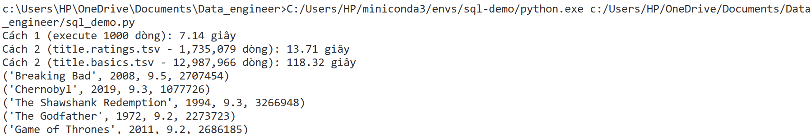

# Lab 2: Nạp Dữ Liệu Quy Mô Lớn Vào MariaDB Bằng Python & Ôn Tập SQL

Repository lưu trữ mã nguồn thực hành, hướng dẫn cài đặt và báo cáo kết quả thực nghiệm nạp dữ liệu hàng triệu bản ghi từ bộ dữ liệu IMDb vào cơ sở dữ liệu quan hệ **MariaDB** bằng **Python**.

---

## 📁 Cấu trúc thư mục

```text
├── sql_demo.py          # Script Python khởi tạo DB, nạp dữ liệu theo 2 cách & truy vấn JOIN
├── Report_Lab2.docx     # Báo cáo chi tiết (Lý thuyết DDL/DML/DQL/DCL/CRUD, hướng dẫn & so sánh)
├── sql-demo.png         # Ảnh chụp màn hình kết quả chạy thực nghiệm
├── .gitignore           # Loại trừ các tệp dữ liệu lớn (*.tsv, *.gz) khi đẩy lên GitHub
└── README.md            # Tài liệu hướng dẫn tổng quan
```

---

## 📊 Bộ dữ liệu sử dụng (IMDb Non-Commercial Datasets)

Dữ liệu được tải từ kho lưu trữ mở chính thức của [IMDb Datasets](https://datasets.imdbws.com/) (định dạng `.tsv` phân tách bằng phím Tab):
* **`title.ratings.tsv` (1.735.079 dòng):** Lưu mã phim (`tconst`), điểm đánh giá trung bình (`averageRating`) và số lượt bình chọn (`numVotes`).
* **`title.basics.tsv` (12.987.966 dòng):** Lưu thông tin chi tiết của tác phẩm (`tconst`, `primaryTitle`, `startYear`, `genres`).

---

## 🚀 Hướng dẫn cài đặt và chạy thực nghiệm

1. **Kích hoạt môi trường ảo và cài thư viện kết nối MariaDB:**
   ```bash
   conda activate sql-demo
   pip install mysql-connector-python
   ```
2. **Chuẩn bị dữ liệu:**
   * Tải 2 tệp `title.ratings.tsv.gz` và `title.basics.tsv.gz` từ trang chủ IMDb.
   * Giải nén lấy 2 tệp `.tsv` đặt nằm cùng thư mục với tệp `sql_demo.py`.
3. **Cấu hình và thực thi:**
   * Mở `sql_demo.py`, cập nhật mật khẩu tài khoản `root` của MariaDB.
   * Chạy chương trình:
     ```bash
     python sql_demo.py
     ```

---

## ⚡ Kết quả đo hiệu năng (Benchmark)

| Phương pháp nạp dữ liệu | Cơ chế thực thi | Quy mô thử nghiệm | Thời gian chạy | Tốc độ trung bình |
| :--- | :--- | :--- | :--- | :--- |
| **Cách 1: Single-Row Insert** | `cursor.execute()` + `commit()` từng dòng | 1.000 dòng *(thử nghiệm)* | **7.14 giây** | ~140 dòng/giây |
| **Cách 2: Batch Insert (`ratings`)** | `cursor.executemany()` theo lô 50.000 dòng | **1.735.079 dòng** | **13.71 giây** | **~126.555 dòng/giây** |
| **Cách 2: Batch Insert (`titles`)** | `cursor.executemany()` theo lô 50.000 dòng | **12.987.966 dòng** | **118.32 giây** | **~109.769 dòng/giây** |

### Kết quả kiểm chứng truy vấn `JOIN` đa bảng
